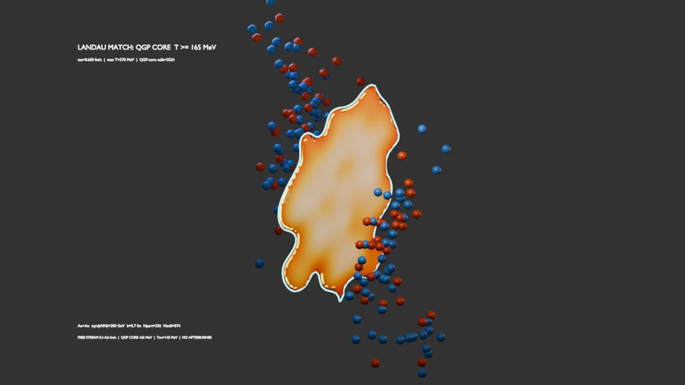
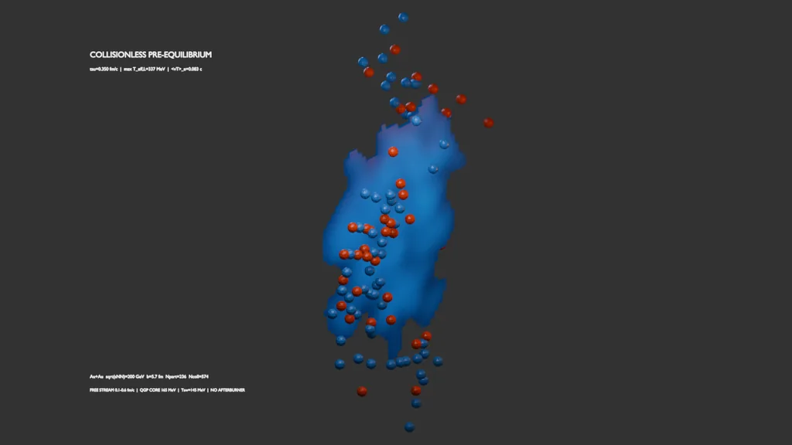
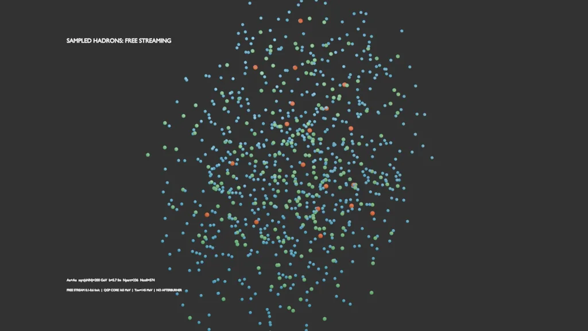

# HIC-simulation

GPU-accelerated numerical and visual prototypes for relativistic heavy-ion
collisions, with a reproducible Blender pipeline for an Au+Au event.

The repository contains three levels of tooling:

- a physics-driven Blender pipeline built from a numerical event cache
- a native PySide field simulator for interactive exploration
- smaller Glauber, hydrodynamics, particlization, validation, and educational tools

The Blender result is generated from calculated fields and sampled particles;
the plasma expansion and particle trajectories are not hand animated.

## Representative result



The reference event is Au+Au at `sqrt(sNN)=200 GeV`, `b=5.7 fm`, seed 17.
The bright interior is the hydrodynamic temperature field, the highlighted
core is `T>=165 MeV`, and the outer contour marks `Tsw=145 MeV`.

| Collisionless pre-equilibrium | Sampled hadrons after particlization |
| --- | --- |
|  |  |

Indicative values from the tested CUDA reference run:

| Observable | Result |
| --- | ---: |
| Glauber geometry | `Npart=236`, `Ncoll=574` |
| Pre-equilibrium interval | `0.1 -> 0.6 fm/c` |
| Maximum Landau effective temperature | `612 -> 370 MeV` |
| Energy-weighted handoff pre-flow | `0.149 c` |
| QGP-core cells at hydrodynamization | `3524` |
| Sampled hadrons | `900` |
| Mean transverse momentum | `0.449 GeV` |
| Reaction-plane `v2` | `0.0119` |

These values are regression references rather than experimental predictions.
The complete run writes a 13-second, 1280 x 720, 24 fps Blender animation and
a machine-readable physics audit.

## Physics scope

The reference Blender event uses:

1. Woods-Saxon Au nuclei and event-by-event Monte Carlo Glauber geometry
2. wounded-nucleon plus binary-collision energy deposition
3. transverse collisionless free streaming from `tau=0.1` to `0.6 fm/c`
4. transport of `T00`, `T0i`, and `Tij`, with timelike-eigenvector Landau matching
5. a tabulated crossover equation of state
6. boost-invariant 2+1D ideal relativistic hydrodynamics
7. a `Tsw=145 MeV` isothermal surface
8. positive-contribution Cooper-Frye sampling of pion, kaon, and proton classes
9. ballistic free streaming of sampled hadrons

The visualization marks a `T>=165 MeV` QGP core separately from the 145 MeV
particlization contour. The pre-equilibrium color field uses a Landau-frame
effective temperature as a diagnostic; it is not a claim of local thermal
equilibrium before hydrodynamization.

This is a physically constrained prototype, not a precision event generator.
It does not include second-order viscous hydrodynamics, a full 3+1D kinetic
pre-equilibrium solver, jet-medium interactions, resonance decays, or a
SMASH/UrQMD hadronic afterburner.

## Quick start

Requirements:

- Windows PowerShell
- Python 3.11 or newer
- Blender 5.1 or compatible for the Blender scene
- FFmpeg on `PATH` for MP4 encoding
- an NVIDIA GPU for the default CUDA 12.8 setup, or use CPU mode

Create the local environment:

```powershell
git clone https://github.com/NhWee/HIC-simulation.git
cd HIC-simulation
.\setup.ps1
```

For a machine without a compatible NVIDIA GPU:

```powershell
.\setup.ps1 -Cpu
```

To select a particular Python installation:

```powershell
.\setup.ps1 -PythonExe "C:\Path\To\python.exe"
```

## Reproduce the Blender result

Run validation, calculate the reference event, build the scene and previews,
and render the 13-second H.264 animation:

```powershell
.\run_reproduce_blender.ps1
```

CPU-only reproduction is supported but slower:

```powershell
.\run_reproduce_blender.ps1 -Cpu
```

Skip the full animation while checking the numerical cache, audit, scene, and
representative PNG previews:

```powershell
.\run_reproduce_blender.ps1 -SkipAnimation
```

The reference configuration is fixed by the reproduction script:

- Au+Au at `sqrt(sNN)=200 GeV`
- impact parameter `b=5.7 fm`
- random seed `17`
- `160 x 160` transverse grid
- 48 pre-equilibrium angular streams
- 900 sampled particles

Generated files are written to `outputs/` and intentionally ignored by Git.
See [REPRODUCIBILITY.md](REPRODUCIBILITY.md) for tested versions, expected
audit values, manual commands, and determinism notes.

## Blender controls

Calculate a new event and build the scene:

```powershell
.\run_blender_hic_scene.ps1
```

Change collision geometry or open the finished scene:

```powershell
.\run_blender_hic_scene.ps1 -ImpactParameter 9.0 -Seed 31 -Open
```

Reuse an existing event cache and render the animation:

```powershell
.\run_blender_hic_scene.ps1 -ReuseCache -RenderAnimation -NoPreviews
```

If Blender is not on `PATH`, pass its executable explicitly:

```powershell
.\run_blender_hic_scene.ps1 -BlenderPath "C:\Program Files\Blender Foundation\Blender 5.1\blender.exe"
```

## Validation

Run the hydrodynamic validation suite:

```powershell
.\run_hydro_validation.ps1 --output outputs\hydro_validation.csv
```

It checks uniform rest and boosted states, Gaussian-fireball conservation,
analytic Bjorken cooling, and crossover-EoS substep convergence. Additional
benchmarks are available through:

```powershell
.\run_hydro_convergence.ps1 --grid-sizes 40,60,80 --cfl-values 0.15,0.25,0.35
.\run_hydro_shock_tube.ps1
```

The Blender event generator also writes
`outputs\blender_physics_event.audit.json` and exits unsuccessfully if its
causality, monotonicity, Landau-handoff, freeze-out, or particle checks fail.

### Automated tests

The `pytest` suite runs on CPU on Linux and Windows (GitHub Actions,
`.github/workflows/tests.yml`) and takes about half a minute:

```powershell
python -m pip install -r requirements-cpu.txt -r requirements-test.txt
python -m pytest
```

It covers the validation tools above, Glauber geometry sanity checks, and an
end-to-end run of the reference event compared against
`tests/reference/blender_event_audit.json` with per-observable tolerances.
After an intentional physics change, regenerate that file with
`python -m tests.reference_event` and commit it with the change.
`tests/test_known_issues.py` holds strict `xfail` checks for the defects listed
in [docs/ROADMAP.md](docs/ROADMAP.md); a fix turns them into XPASS failures, and
the marker is removed together with the fix.

## Other entry points

| Command | Purpose |
| --- | --- |
| `.\run_pyside_simulator_app.ps1` | Native interactive field and hadronization simulator |
| `.\run_glauber_ensemble.ps1 --events 200` | Monte Carlo Glauber event ensemble |
| `.\run_centrality_analysis.ps1` | Centrality-binned geometry analysis |
| `.\run_ideal_hydro_2d.ps1 --bjorken-expansion` | Standalone ideal-hydro prototype |
| `.\run_particlization.ps1` | Standalone freeze-out particle sampling |
| `.\run_event_pipeline.ps1 --events 3` | Small multi-event numerical pipeline |
| `.\run_visualize_results.ps1` | Plotly report from generated CSV files |
| `.\run_visual_simulation.ps1` | Browser-playable qualitative simulation |
| `.\run_educational_visual.ps1` | Classroom-style educational board |
| `.\run_educational_simulator_app.ps1` | Lightweight native educational simulator |

## Repository layout

```text
data/                       compact crossover EoS table
docs/                       model notes
hic/                        numerical models and applications
tools/blender_hic_scene.py  cache-to-Blender scene builder
run_*.ps1                   reproducible Windows entry points
outputs/                    generated caches, reports, scenes, images, and video
```

## Model references

- [Free-streaming approximation and Landau matching](https://arxiv.org/abs/0812.3393)
- [Universal early transverse flow](https://arxiv.org/abs/0810.4325)
- [KoMPoST kinetic pre-equilibrium framework](https://arxiv.org/abs/1805.00961)
- [Cooper-Frye particlization](https://doi.org/10.1103/PhysRevD.10.186)
